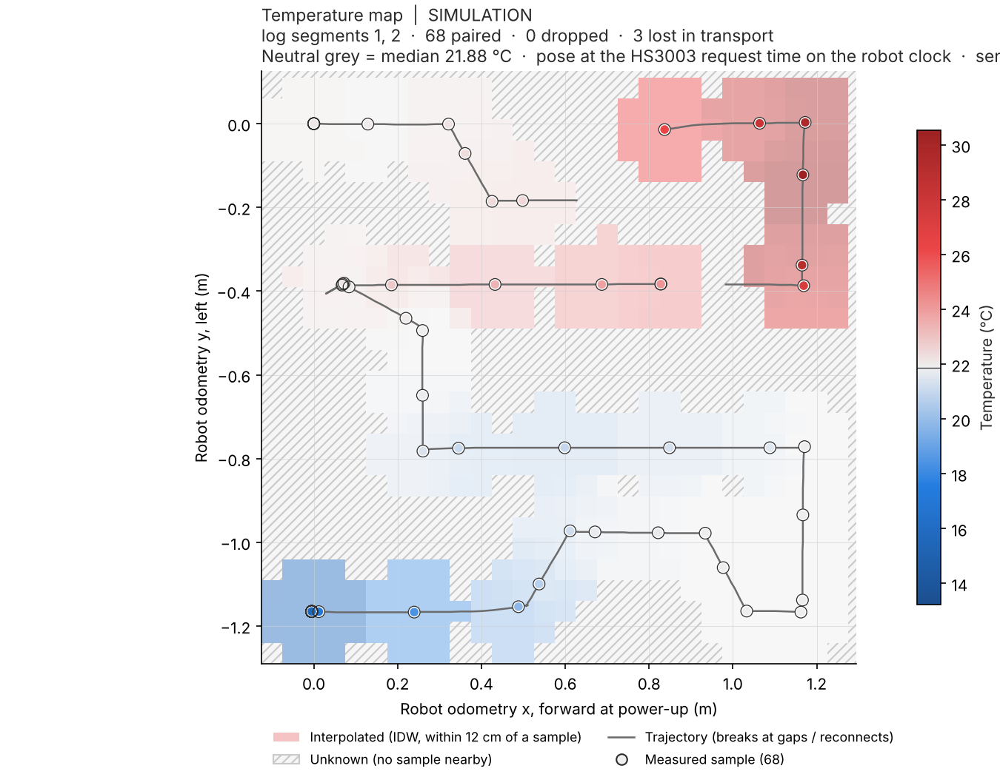

# 倾斜遥控、低电量指示与温度热图

适用于**两块 Arduino Nano 33 BLE Sense Rev2、DRV8833 直连版**（`firmware/robot`、`firmware/remote`）。不适用于 `firmware/revd`。电脑仍然只接收、记录和画图，不参与车辆控制。

分支 `feature/gesture-battery-heatmap`，由 `feature/telemetry-compare`（cb4c6ad）合并 `feature/sil-sim`（ce128ff）后开发。

## 状态一览

| 项目 | 编译 / 仿真 | 实车 |
| --- | --- | --- |
| 两块 sketch 编译（`arduino:mbed_nano:nano33ble`，核心 4.6.0） | 通过，默认和 `--trace-accepted` 台架版各两份 | 待刷板 |
| 倾斜遥控、模式切换、急停、断链、IMU 失效 | 主机测试和 5 个固件场景通过，各 10 个种子 | **待实车验证** |
| 手动模式断链停驱动 | 仿真 10 个种子 449.4–450.9 ms（最后一个有效包 → D8 拉低） | **待台架测量**，仿真值不是实测 |
| 低电量指示 | 主机测试和 1 个固件场景通过 | **分压和阈值均待万用表实测** |
| 热图 | 主机测试通过，仿真 CSV 回放出图 | **待冷热区实跑** |

## 1. 倾斜遥控

### 手持板

| 操作 | 作用 |
| --- | --- |
| 上电后**平放静止约 0.5 s** | 自动校零。姿态偏离水平超过 30°、或手在晃动时不会完成校零，输出保持 0 |
| 前端（USB 口朝外的一端）下压 | 前进；后端下压为后退 |
| 右边下压 | 原地右转（顺时针）；左边下压为左转 |
| D2 常开按钮接地 / 串口 `e` | **急停**，与原来相同，未改动 |
| D4 常开按钮接地（可选）/ 串口 `z` | 重新校零。以当前姿态为新零点，完成前输出为 0 |
| 串口 `t` | 开关方向核对输出，每 200 ms 一行 `TILT 状态 pitch roll v w`。记录器会忽略这些行 |

映射参数在 `firmware/remote/remote.ino` 的 `tiltConfig()`：死区 ±5°，25° 满量程，满量程 0.25 m/s、2.0 rad/s，斜率 0.6 m/s²、6 rad/s²。`pitchSign`、`rollSign` 改方向。其余默认值见 `libraries/Mech368Control/src/TiltSteering.h`。

失效处理：无 IMU、校零中、超过 100 ms 没有新的加速度样本、样本不合理（|a| 不在 0.8–1.2 g 或非数值）时，输出**立即**为 0，不经斜率缓降。数据恢复后，必须先回到死区内（中立位）才重新输出，手还倾着时恢复不会让车冲出去。

手持板 RGB 灯：红＝无 IMU 或校零中；品红＝等待回到中立位；绿＝已校零、输出为 0；蓝＝正在发出运动指令。橙色 L 灯仍表示链路健康，与原来相同。

### 车端模式切换（车上 APDS-9960 手势）

| 手势 | 作用 |
| --- | --- |
| 左挥 LEFT | 选择 MANUAL。若正在行驶，**先停车**，不启动 |
| 右挥 RIGHT | 选择 AUTO（巡线避障）。若正在行驶，**先停车**，不启动 |
| 上挥 UP | 启动所选模式。未选择、没有新鲜心跳、或 MANUAL 时手持板不在中立位，都会拒绝并在车端 USB 打印原因 |
| 下挥 DOWN | 停车，回到 IDLE |
| 急停锁存期间的任意手势 | **只解锁**，不选模式、不启动 |

上电后什么都没选，UP 无效。选择不会启动；重连、心跳恢复、解除急停都不会启动；只有单独一次 UP 才启动。所选模式在停车后保留，所以 AUTO 停车后再次 UP 仍是 AUTO。急停键仍是手持 D2 和串口 `e`，没有被占用。

车端 RGB 灯（低电平点亮）：

| 颜色 | 含义 |
| --- | --- |
| 蓝色 1 Hz 慢闪 | IDLE，尚未选择 |
| 蓝色常亮 | IDLE，已选 AUTO |
| 品红常亮 | IDLE，已选 MANUAL |
| 青色 | AUTO 标定扫描中 |
| 绿色 | AUTO 巡线中 |
| 黄色 | MANUAL 行驶中 |
| 红色 | 导航因丢线或受阻自行停车，下一次手势后熄灭 |

板载橙色 L 灯仍是 BLE 失联 / 超时 / 急停的 8 Hz 闪烁，含义不变。

### 安全链

- 协议帧格式和版本未改。运动帧原有的 `linear`（mm/s）和 `angular`（mrad/s）字段过去恒为 0，现在由手持板按倾角填写，并钳位到协议界限。旧版遥控器仍可连上，只是 MANUAL 下车不会动。
- 车端只在 MANUAL 时使用这两个值，且读取的是 `Receiver::linear(now)`：MotionSafety 不允许运动时恒为 0。重复包、乱序、旧挑战码、CRC 错误都不会刷新许可。车端再按 0.30 m/s、3.0 rad/s 钳位（`robot.ino` 的 `kManualMax*`），并做 1 m/s²、8 rad/s² 斜率限制，最后经 `limitTwist` 限制单轮速度。
- MANUAL、AUTO 和 IR 标定扫描都只通过 `DirectLineTracker::updateDrive()` 写电桥。每次写之前重新读 `motionPermitted()` 和 DRV8833 nFAULT，任一失败就拉低 D8 并停止。450 ms 软件超时不变。
- 手持板在每条状态通知后才回一条指令，IMU 读取在循环开头完成，不夹在状态和回复之间。遥测的 ACL 预留（至少保留 1 个缓冲给控制）不变。

### 方向核对（台架，电机断开）

1. 两板上电，手持板平放静止，RGB 变绿。
2. 用 Arduino 串口监视器打开**手持板** COM，输入 `t`。前端下压时 `v` 应为正，右边下压时 `w` 应为负。不对就改 `tiltConfig()` 的符号。核对完再输入 `t` 关闭。记录器占用 COM 时不能同时开串口监视器。
3. 车上左挥，RGB 变品红。手持板保持平，车上上挥，RGB 变黄，D8 为高。倾斜时 DRV8833 输出端应有占空比（可用万用表或示波器看 AOUT/BOUT），放平后回零。
4. 手持板倾着时在车上下挥再上挥，应被拒绝（D8 保持低）。

## 2. 低电量指示

### 接线

- 车端 **D1 → 1 kΩ → 红色 LED → GND**，在车壳上贴 “LOW BAT” 标签。这是主指示，低电时常亮。
- 不接线时的备用指示：板载绿色电源灯每 2 s 熄灭两下。
- 两者都与橙色 L 灯（BLE 失联 8 Hz 闪烁）颜色、位置、节奏不同。
- 固件只指示，**不会**因低电自动断电或停车。

### 判定逻辑

每 50 ms 读一次 A7。电池电压 = ADC × 3300/1023 × 分压比，经 1 s 时间常数低通滤波。滤波值低于“低电阈值”**连续 5 s** 才点亮；高于更高的“恢复阈值”**连续 10 s** 才熄灭。两阈值之间保持原状态。电机起步造成的短时压降（仿真中 0.8 s 降到 5.6 V，两次）不会点灯。滤波值低于 1.5 V 视为未接电池（USB 供电台架），不点灯，遥测报告为“无电池”。

### 参数（全部待实测）

| 参数 | 当前值 | 位置 | 状态 |
| --- | --- | --- | --- |
| 分压比 Vpack / VA7 | 3.0 | `DriveCalibration.h` 的 `batteryDivider`，遥测 `battery_mv` 共用 | **暂定**，电阻值未知 |
| ADC 参考 | 3300 mV，10 位 | `BatteryConfig` | 待用万用表量 3V3 |
| 低电阈值 | 6400 mV | `robot.ino` 的 `batteryConfig()` | **猜测**：按 7.2 V 级电池包（6 节镍氢或 2S 锂电） |
| 恢复阈值 | 6800 mV | 同上 | **猜测** |
| 低电保持 / 恢复保持 | 5 s / 10 s | 同上 | 可按实跑调整 |

若实际是 4 节 AA（约 6 V），阈值必须改小（例如 4600 / 4900 mV，同样待实测）。分压比 3 时 A7 满量程对应 9.9 V，电池最高电压超过这个值必须换分压电阻。

### 万用表对照步骤

1. 断开电机，车板由电池供电。量电池两端 Vpack、A7 对 GND 的 VA7、3V3 对 GND 的 Vref。
2. 分压比 = Vpack / VA7，填入 `batteryDivider`。若 Vref 与 3300 mV 相差超过 1%，同时改 `adcRefMv`。
3. 重新编译刷板，用记录器录一段，比较 CSV 的 `battery_mv` 与万用表 Vpack，相差应在 2% 内。
4. 按电池化学体系和厂家放电曲线定低电阈值，恢复阈值比它高约 0.3–0.4 V。
5. 有可调电源时，用它代替电池（电机断开）：从额定电压降到阈值以下，约 6–7 s 后 LOW BAT 亮；升到两阈值之间应保持亮；升到恢复阈值以上约 11 s 后熄灭。把实际阈值和时间记入验收表。

遥测环境帧状态字节的高四位新增两列：`drive_mode`（idle、manual、auto）和 `battery_state`（unknown、ok、low、absent）。`safety_flags` 仍只取低四位。

## 3. 温度热图

### Windows 命令

在仓库根目录打开 PowerShell。依赖与 [遥测记录](TELEMETRY.zh-CN.md) 相同（`tools/requirements-telemetry.txt`）。输出文件名必须是新的。

```powershell
.\scripts\telemetry.ps1 heatmap examples\heatmap\reconnect.csv --output build\heatmap.png --pairs build\heatmap-pairs.csv
```

实跑记录：

```powershell
.\scripts\telemetry.ps1 record --port COM5 --run live --output heat-run.csv
```

```powershell
.\scripts\telemetry.ps1 heatmap heat-run.csv --output heat-run.png --pairs heat-run-pairs.csv
```

可选参数：`--log-segment N` 只画一段；`--max-gap-ms` 位姿插值的最大间隔（默认 250）；`--cell` 插值格大小（默认 0.05 m）；`--radius` 离最近样本多远以外算未知（默认 0.12 m）；`--points-only` 只画实测点。

### 配对规则

- 温度时刻 = 环境帧的 `robot_ms` − `temp_age_ms`，即车端发出 HS3003 转换请求的时刻。完全不用 PC 收包时间。
- 在**同一** `log_segment` 内找夹住该时刻的两帧位姿，线性插值。两帧间隔超过 250 ms 或中间有丢帧（`gap`>0）就丢弃，不跨重连段、不跨长缺口插值。
- 多段默认合在一张图里，但要求后一段的车端时钟晚于前一段结束（车没重启，里程计坐标连续），否则报错，要求用 `--log-segment` 选一段。
- 丢弃原因：无有效温度、无转换时间、该段无位姿、早于该段第一帧位姿、晚于最后一帧位姿、位姿缺口、位姿越界或陀螺零偏未就绪。传输中整帧丢失的环境帧不在 CSV 里，按序号缺口另行统计。

### 图的读法

- 实心圆点＝实际采样点，颜色为实测温度。
- 浅色方格＝反距离加权插值，只填离样本 12 cm 以内的格子，颜色比实测点淡。
- 斜线灰底＝未知，没有附近样本，不做外推。
- 灰线＝轨迹，在缺口和重连处断开。
- 色标为蓝–灰–红发散色，中性灰为本次实测温度中位数。坐标是车上电时的里程计系（x 向前、y 向左）。
- 未补偿温度传感器的响应滞后。读数落后于车经过的空气，热区在图上会沿行驶方向偏后。这是传感器特性，不是场地的实测结论。

### 示例结果（仿真，不是实测）

`examples/heatmap/reconnect.csv` 来自固件仿真 `heatmap_reconnect_course`：实际 robot/remote sketch 跑讲义赛道，11.5–14.5 s 手持 USB 拥塞，20.5–22.0 s 断链重连，24.5 s 单独上挥重新启动后跑完全程。温度场是仿真假设值（环境 22 °C，热角 +12 °C，冷角 −8 °C）。

| 项目 | 结果 |
| --- | --- |
| 日志段 | 1、2（重连后新段，车端时钟连续） |
| 收到的温度帧 | 68 帧，68 帧配对成功，0 帧丢弃 |
| 传输丢失 | 3 帧（USB 拥塞期间整帧未到达，按序号缺口统计） |
| 输出 | [heatmap.png](../examples/heatmap/heatmap.png)、[逐帧配对结果 pairs.csv](../examples/heatmap/pairs.csv) |

已有的 `examples/telemetry/live.csv` 也能直接出图：1 段，48 帧温度全部配对，0 丢弃。各种丢弃原因由 `tests/test_telemetry.py` 的 `HeatmapTests` 用构造数据逐一覆盖。



## 4. 本次验证命令与结果

在 Linux 容器中运行（Windows 上可用 Git Bash 执行同样的脚本，见 [遥测文档的重建一节](TELEMETRY.zh-CN.md)）。

```bash
bash scripts/test-host.sh
```

7 个 C++ 测试程序（含新增 `control_test`、`battery_test`）和 13 个 Python 测试全部通过。

```bash
bash scripts/run-sil.sh
```

原有 SIL 两组输出正常生成。

```bash
bash scripts/run-fw-sim.sh
```

40 个固件场景全部通过（原 33 个 + 新增 7 个：`manual_tilt_drive`、`manual_link_loss`、`manual_estop`、`manual_imu_stale`、`manual_imu_absent`、`battery_low_indicator`、`heatmap_reconnect_course`）。

```bash
bash scripts/run-fw-sim.sh --seeds 10 manual_tilt_drive manual_link_loss manual_estop manual_imu_stale manual_imu_absent battery_low_indicator robot_track_watchdog robot_track_estop robot_track_stop_priority robot_track_recovery_gestures telemetry_deadline telemetry_usb_power_loss telemetry_pressure
```

13 个场景各 10 个种子，130/130 通过。

```bash
python3 scripts/compile_firmware.py
```

```bash
python3 scripts/compile_firmware.py --trace-accepted
```

arduino-cli 1.3.1、`arduino:mbed_nano` 4.6.0、ArduinoBLE 2.1.1、Arduino_APDS9960 1.0.4、Arduino_BMI270_BMM150 1.2.4。robot 380848 字节 Flash（台架版 380912），remote 360280 字节。

```bash
python3 tools/sim_measurements.py raw build/fwsim/heatmap_reconnect_course build/heat/reconnect.csv
```

```bash
python3 tools/telemetry.py heatmap build/heat/reconnect.csv --output build/heat/reconnect.png --pairs build/heat/reconnect-pairs.csv
```

### 回归测试覆盖

| 要求 | 测试 |
| --- | --- |
| 倾角零位和方向 | `control_test`：任意握姿校零、死区、正负方向、满量程限幅、斜率、方向可配置、晃动不校零、超过 30° 拒绝校零、重新校零；`manual_tilt_drive` |
| 手动 / 自动切换 | `control_test` 模式切换；`manual_tilt_drive`：未选择或倾斜时 UP 被拒、右挥先停不启动 |
| IMU 失效 | `control_test`：冻结 100 ms 内归零、恢复须过中立位、异常样本、IMU 丢失、millis 回绕；`manual_imu_stale`、`manual_imu_absent` |
| 急停优先、重连不自启 | `control_test` 锁存期间手势全部被消耗；`manual_estop`；`manual_link_loss`（断链 + 重连 + 倾斜 UP 均不启动）；原有 `robot_track_stop_priority` |
| 低电灯迟滞 | `battery_test`：起步压降、5 s 保持、迟滞带、恢复保持重计时、阈值附近抖动、无电池、可配置；`battery_low_indicator` |
| 热图断线与缺测 | `HeatmapTests`：按车端请求时刻配对、重连段、位姿缺口、缺温度、缺转换时间、陀螺零偏未就绪、车重启检测、未知格为空、PNG 输出 |

## 5. 待你实车验证

按已有的 [双板验收表](../output/pdf/two-board-bench.zh-CN.pdf) 顺序：

1. **断开电机**，两板上电。用记录器确认手持 COM 有回传；CSV 出现 `drive_mode`、`battery_state` 两列。
2. 断链停驱动：MANUAL 黄灯行驶状态下，用台架版（`--trace-accepted`）测 D0 最后一次翻转到 D8 拉低的时间，要求 ≤500 ms；手持板断电一次、D3 接地中断心跳一次。仿真的 449–451 ms 只作参考。
3. 急停与重连：MANUAL 下按 D2，D8 应立即拉低；车上任一手势只解锁；手持倾斜时上挥被拒；放平后上挥才恢复。断链重连后同样必须单独上挥。
4. 方向核对（第 1 节）和 IMU 失效：手持板运行中短暂拔掉其电源或按复位，车应在 450 ms 内停驱动。
5. 低电量：第 2 节万用表步骤，确定分压比和阈值，用可调电源核对点灯和熄灯时间。
6. **接车**后做轮系 / IR 标定（[遥测文档](TELEMETRY.zh-CN.md) 的标定步骤），先 AUTO（右挥再上挥）跑一圈。
7. 冷热区实跑：在冷、热区附近低速 MANUAL 或 AUTO 行驶并记录，用 `heatmap` 出图。记录配对、丢弃和传输丢失数。可在冷热区停留几秒，减小传感器滞后的影响。

已知限制：AUTO 在绕障途中被断链或急停打断后，单独上挥重启时导航从线外开始找线，仿真中会停成 `lost`。这是现有导航的行为，本次未改；实车遇到时应手动把车放回线上再启动。
